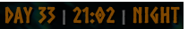

# WorldClock

See the time in Valheim without opening a menu. WorldClock displays the current in-game time as a small, configurable HUD label.

## Features

- Choose a .NET custom time format, such as `HH:mm`, `h:mm tt` or `HH:mm:ss`.
- Customize the entire label using `{time}`, `{day}` and `{phase}` placeholders.
- Style individual parts with bold, font size and hex colors. The default is bold Norsebold text with a subtle shadow.
- Select loaded Unity fonts by name and enable a scrollable, column-aligned font sampler.
- Position the clock with screen-width and screen-height fractions.
- Disable the mod if you do not want the clock displayed.
- The clock is local to your client; servers do not need to install it.

## Installation

Install with r2modman or the Thunderstore Mod Manager. Requires **BepInExPack_Valheim**, which the mod manager installs for you.

For manual installation, place `WorldClock.dll` in `BepInEx/plugins/WorldClock/`.

## Configuration

Edit `BepInEx/config/hoose.valheim.worldclock.cfg` or use a compatible configuration manager.

| Setting | Default | Description |
| --- | --- | --- |
| Display format | `<b><font size=24 color=#FF8E0080>Day {day} <font size=18 color=#B4B4B480>\|</font> {time} <font size=18 color=#B4B4B480>\|</font> {phase}</font></b>` | Whole label template; include or omit `{time}`, `{day}` and `{phase}` as desired. |
| Time format | `HH:mm` | .NET custom date and time format string. |
| Horizontal position | `0.07` | `0` places the label at the left edge, `0.5` centers it and `1` places it at the right edge. |
| Vertical position | `0` | Top edge from top (`0`) to bottom (`1`). Existing values are preserved. |
| Show font demo | `false` | Display all currently available fonts on screen, one per row. Open the game menu (Esc) and use the mouse wheel over the list to scroll. |
| Sample text | `Day 42 \| 12:00` | Text shown beside each font name in the sampler. |

Day phases use fixed hour ranges:

- 00:00-03:59 Late Night
- 04:00-05:59 Before Dawn
- 06:00-07:59 Dawn
- 08:00-11:59 Morning
- 12:00-13:59 Midday
- 14:00-16:59 Afternoon
- 17:00-19:59 Evening
- 20:00-23:59 Night

### Display formatting

The placeholders are `{time}` for formatted time, `{day}` for the day number, and `{phase}` for the day phase. Write any labels and separators directly in the template. The default format is:

```text
<b><font size=24 color=#FF8E0080>Day {day} <font size=18 color=#B4B4B480>|</font> {time} <font size=18 color=#B4B4B480>|</font> {phase}</font></b>
```

For example, the default format looks like this in game:



Colors and opacity will appear differently against different backgrounds.

Other examples:

```text
<font size=24 color=#FFD060><b>Day {DAY}</b></font> | <font color=#80DFFF>{Time}</font> | {phase}
<font name="Norse" size=24 color=#FFD060>Day {day}</font> | <font name="Arial">{time}</font>
```

Use `<b>...</b>` for bold and `<font name="Norse" size=24 color=#RRGGBB>...</font>` for font name, size and color, either separately or together. Font tags can be nested. Size is in pixels (1-256); colors accept `#RRGGBB` or `#RRGGBBAA`. The shadow retains the font, sizing and bold styling without inheriting foreground colors.

Hex colors are adjusted for Unity's linear color space to better match the configured color; alpha is unchanged. Actual appearance can still vary with transparency, antialiasing and the background.

Font names are looked up among Unity `Font` resources currently loaded by the game. The default font is Norsebold at size 22 when no size is specified; the default template specifies sizes 24 and 18. An unavailable requested or default font is reported on screen and in the BepInEx log rather than silently substituted. The sampler lists currently loaded, usable fonts, displays names and instructions in AveriaSansLibre-Bold when available, and aligns samples in a separate column, wrapping long text within its column. If that label font is unavailable, the sampler uses the Unity GUI label font and logs a warning. It marks Norsebold as `(default)`. Font availability may vary by game build and session; font names cannot contain angle brackets, quotes or control characters.

Existing display formats are preserved, including any explicit sizes or font names. Change them or regenerate the configuration to use the new template.

Edit **Display format** to choose which parts appear and how they are styled.

Time formats follow the [.NET custom date and time format strings](https://learn.microsoft.com/dotnet/standard/base-types/custom-date-and-time-format-strings) syntax. An invalid time or display format is logged and shown as an explicit clock-format error rather than silently replaced.

Each `{time}` reserves space based on the widest time in a day using its configured font and styling, less two pixels on the right, keeping surrounding text steady as the digits change. The first measurement is cached; formats displaying seconds have many possible values and may take longer to measure. Other changes, such as a new phase or day, can still change the width of the whole label. Closely spaced text can overlap the time's right edge in some fonts.

## Stack with other mods

WorldClock is a client-side HUD display and can be used alongside [AutoRepair](https://github.com/dhamhuis/ValheimMods/tree/main/AutoRepair), [CraftFromStorage](https://github.com/dhamhuis/ValheimMods/tree/main/CraftFromStorage), [CookFromStorage](https://github.com/dhamhuis/ValheimMods/tree/main/CookFromStorage) and [SupplyFromStorage](https://github.com/dhamhuis/ValheimMods/tree/main/SupplyFromStorage).

[Project and support](https://github.com/dhamhuis/ValheimMods)